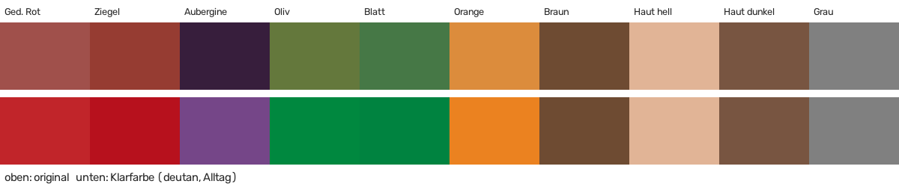

# Klarfarbe

**Open library for personal colour assistance for people with red-green colour vision deficiency.**
**Offene Bibliothek für persönliche Farbhilfe bei Rot-Grün-Schwäche.**



## Worum es geht

Etwa acht Prozent der Männer sehen Farben eingeschränkt, meist auf der Rot-Grün-Achse. Bestehende Hilfen färben das ganze Bild um oder benennen nur Farben. Klarfarbe geht anders vor:

1. **Ein persönliches Profil** beschreibt Typ (Protan, Deutan) und Stärke der Farbsehschwäche.
2. **Ein Kategorie-Modell** ordnet jedem Farbwert eine Grundfarbe mit Sicherheitswert zu, auch wenn die Farbe gedeckt ist.
3. **Gezieltes Einrasten:** Nur eindeutig erkannte Farben werden auf einen Ton gezogen, den die Person sicher unterscheidet. Ein gedecktes Rot wird klar rot, eine dunkle Aubergine wird erkennbar lila.
4. **Totzone:** Unsichere Farben sowie Grau, Schwarz und Weiß bleiben unverändert. Klarfarbe täuscht keine Sicherheit vor.
5. **Hautton-Schutz:** Hauttöne aller Schattierungen bleiben im Alltagsmodus unverändert. Im Handwerksmodus (`--handwerk`) ist der Schutz aus, damit z. B. braune Adern deutlicher werden.

Klarfarbe ist eine **Hilfe zur Farbunterscheidung**. Es ersetzt keine Prüfung und keine Sicherheitsmessung, etwa beim Arbeiten an elektrischen Anlagen.

## Browser-Demo

`web/index.html` ist eine eigenständige Seite: Testbild, eigene Fotos oder Kamera, Vergleich per Trennlinie, Export als Profil und `.cube`. Die Farbumrechnung läuft als WebGL2-Shader mit einer 3D-Nachschlagetabelle.

```bash
python3 -m http.server 8000   # im Hauptordner des Repos
# dann http://localhost:8000/web/ öffnen (Kamera funktioniert nur über http://localhost oder https)
```

### Tragbar ausprobieren

- **Smartphone mit Pappbrille** (z. B. Google-Cardboard-Halterung, ca. 15 €): Demo über GitHub Pages auf dem Handy öffnen, **Pappbrille** wählen, Handy quer einstecken. Klarfarbe läuft dann auf der Rückkamera, für beide Augen.
- **Meta Quest 3:** Seit Quest-Browser 40.1 sind die Passthrough-Kameras als normale Kameras erreichbar („camera 1, facing back“ = links). Demo im Quest-Browser öffnen, **Vollbild** wählen, im Kameramenü die hintere Kamera nehmen. Das ist ein erster Test ohne App. Für echtes Passthrough im ganzen Sichtfeld folgt das Unity-/OpenXR-Paket.
- Antippen oder `Esc` beendet den Modus. Die Kamera funktioniert nur über `https://` oder `http://localhost`.

Mit GitHub Pages (Settings → Pages → Branch `main`, Ordner `/root`) ist die Demo öffentlich unter `https://<name>.github.io/Klarfarbe/web/` erreichbar. Nach Änderungen an `js/klarfarbe.js` oder `web/template.html`: `python3 web/build.py`.

## Schnellstart (macOS, Linux, Windows)

```bash
cd python
python3 -m venv .venv && source .venv/bin/activate
pip install -r requirements.txt

# Live-Webcam: links Original, rechts Klarfarbe
python demo_webcam.py --type deutan --severity 0.6

# Ein Foto umwandeln
python -m klarfarbe.cli image foto.jpg foto_klar.jpg --type deutan

# LUT für Premiere, DaVinci Resolve, OBS exportieren
python -m klarfarbe.cli cube klarfarbe_deutan.cube --type deutan

# Tests (35, inklusive Abgleich Python ↔ JavaScript, braucht Node.js)
pip install pytest && python -m pytest tests
```

Tasten in der Webcam-Demo: `q` beenden, `v` Ansicht wechseln, `h` Hautton-Schutz an/aus, `t` Protan/Deutan, `+`/`-` Sicherheitsschwelle.

## Aufbau

| Pfad | Inhalt |
| --- | --- |
| `python/klarfarbe/oklab.py` | sRGB ↔ Oklab, vektorisiert |
| `python/klarfarbe/categories.py` | Kategorie-Modell mit Sicherheitswert, Hautton-Erkennung |
| `python/klarfarbe/snap.py` | Einrasten, 3D-LUT, `.cube`-Export |
| `python/klarfarbe/profile.py` | Profilformat lesen und schreiben |
| `python/klarfarbe/profiletest.py` | Profiltest (D-15-Prinzip), Auswertung nach Vingrys & King-Smith, Kalibrierung mit simulierten Betrachtern |
| `spec/profile-format.md` | Offene Spezifikation des Profilformats |
| `js/oklab.js` | Oklab-Umrechnung für Browser und Adobe-UXP |
| `js/klarfarbe.js` | Kompletter Kern in JavaScript, ergebnisgleich mit Python (automatisch getestet) |
| `web/` | Browser-Demo mit WebGL2-Shader |

## Profiltest

Zwei Runden Farben ordnen (kräftig, dann blass), Prinzip des Farnsworth-D-15. Die Auswertung nach Vingrys und King-Smith (1988) liefert einen Verwechslungsindex (1,00 = fehlerfrei, ab 1,60 auffällig) und eine Verwechslungsachse.

- Scheitert schon die kräftige Runde: deutliche Ausprägung, Typ aus der Achse (Protan etwa +9°, Deutan etwa −3° in Oklab a/b).
- Scheitert nur die blasse Runde: mittlere Ausprägung. Den Typ meldet der Test hier bewusst nicht, weil er bei dieser Stärke in der Simulation in rund einem von fünf Fällen falsch lag.
- Beide bestanden: keine oder leichte Farbsehschwäche.

Die Grenzwerte sind mit simulierten Betrachtern (Machado et al. 2009) kalibriert, siehe `profiletest.calibrate()`. Der Test läuft auf unkalibrierten Bildschirmen und ist **kein medizinischer Test**. Er liefert einen Startwert für das Profil.

## Stand und Plan

Version 0.1 ist ein lauffähiger Prototyp. Geplant (siehe Prototype-Fund-Antrag): Validierung des Profiltests mit Betroffenen, gelerntes Farbnamen-Modell, Shader in GLSL, WGSL und Metal, Browser-Erweiterung, iOS-Kamera-App, Unity-Paket für Passthrough auf der Meta Quest 3, Nutzertests mit Betroffenen.

## Lizenz

Apache-2.0, siehe [LICENSE](LICENSE). Copyright 2026 Mohammad Al-Musawi.
